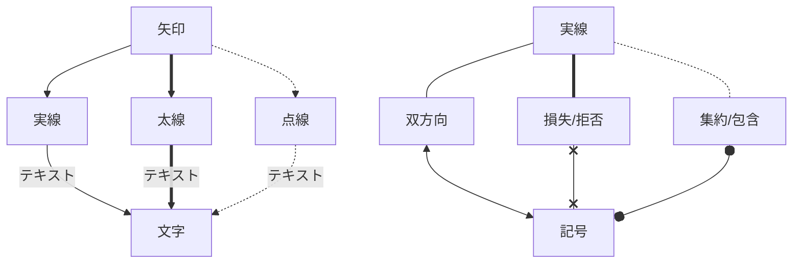
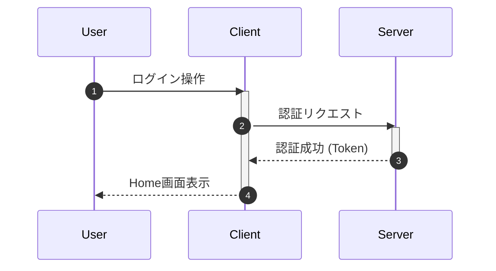

# 使い方
- ログインが必須（画面右上のログインから）
- 作業名・プロジェクト名・作業区分を入力して開始を押すと集計開始
  - すべて空でも入力できるので、とりあえずボタンだけおして後から編集することも可能
  - 終了を押さずに開始を押せば前の作業は自動で終了する
- 「空きを埋める」を押すと、連続していない時間を「事務作業」で埋める
- 開始・終了・登録・編集・削除の成功後は、処理の完了を待って画面を自動更新する。失敗時はエラーを表示する。
- 昼休み（11:45〜12:45）・デイリースクラム（11:00〜11:30）・昼礼（13:00〜13:15）は開始・終了時刻をまとめて保存する。昼礼は作業中の記録があれば13:00に終了させてから登録する。

## Auth0設定

- `AUTH0_DOMAIN`: スキームやパスを含まないAuth0のドメイン名。
- `AUTH0_CLIENT_ID`、`AUTH0_CLIENT_SECRET`: Auth0アプリケーションの認証情報。
- `AUTH0_CALLBACK_URL`: Auth0に登録したコールバックURL（HTTPまたはHTTPSの絶対URL）。
- `AUTH0_AUDIENCE`: Auth0 APIのIdentifier。ログイン時の要求とアクセストークンの検証に共通で使用する。未指定時は従来どおり `http://localhost:3000/`。

アクセストークンは署名、発行元、対象API、有効期限、ユーザーIDを検証する。
認証情報が不正な場合は401を返し、後続処理を実行しない。
JWKSの取得にはリクエストのキャンセルと5秒のタイムアウトを適用し、取得失敗時は502を返す。
既存データとの互換性のため、ユーザーIDには引き続き `sub` の `provider|id` の `id` 部分を使用する。

